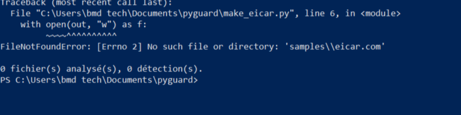
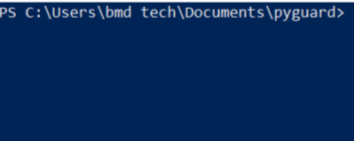
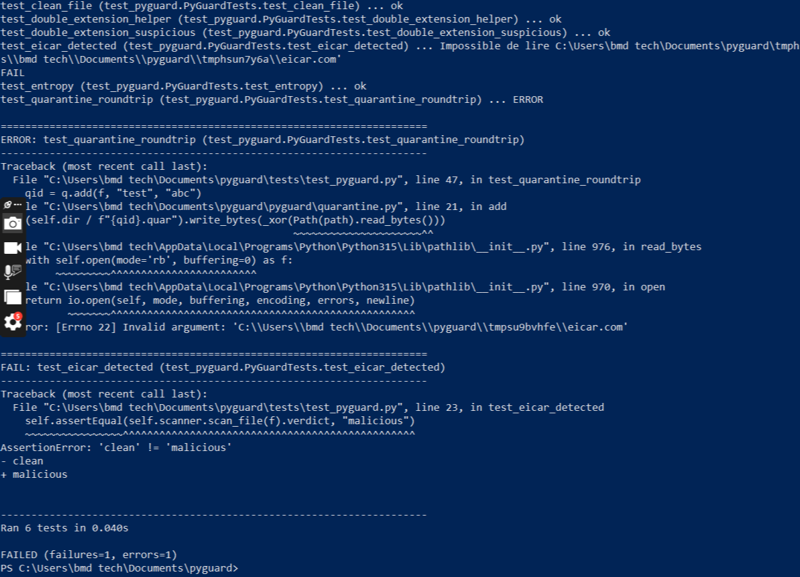

# PyGuard : mini antivirus en Python
## Aperçu

### Détection et mise en quarantaine d'EICAR


### Contenu de la quarantaine


### Tests unitaires


Projet éducatif de portfolio : un scanner de fichiers combinant détection par signatures,
règles YARA, analyse heuristique statique, quarantaine et surveillance en temps réel.

## Installation

```bash
python -m venv .venv && source .venv/bin/activate   # Windows : .venv\Scripts\activate
pip install -r requirements.txt
```

`pefile`, `watchdog` et `yara-python` sont optionnels : sans eux, les modules correspondants sont désactivés.

## Utilisation

```bash
python main.py scan ./dossier                 # analyser un dossier
python main.py scan ./dossier --quarantine    # isoler les fichiers malveillants
python main.py scan fichier.exe --json        # sortie JSON
python main.py monitor ./Downloads --quarantine   # temps réel
python main.py list                           # voir la quarantaine
python main.py restore <id>                   # restaurer un fichier
```

## Tester sans risque

Crée un fichier contenant la chaîne EICAR (inoffensive, standard de test des antivirus) :

```bash
python make_eicar.py samples/eicar.com
python main.py scan samples
```

Lance les tests : `python -m unittest discover -s tests -v`

## Architecture

| Module | Rôle |
|---|---|
| `pyguard/hashing.py` | SHA-256 par blocs |
| `pyguard/heuristics.py` | entropie, double extension, imports PE suspects |
| `pyguard/yara_engine.py` | chargement et application des règles YARA |
| `pyguard/scanner.py` | orchestration : signatures, YARA, heuristiques, verdict |
| `pyguard/quarantine.py` | isolation, métadonnées, restauration |
| `main.py` | interface en ligne de commande |

## Limites (à mentionner dans ton portfolio)

- Pas d'analyse comportementale ni de protection noyau : ce n'est pas un remplaçant d'un vrai antivirus.
- Le XOR de la quarantaine est de l'obfuscation, pas du chiffrement.
- La base de signatures est minimale : à enrichir avec des hashs publics (ex. MalwareBazaar).

## Pistes d'évolution

Interface graphique, mise à jour automatique des signatures, analyse de scripts (PowerShell, JS), scoring par apprentissage automatique, intégration VirusTotal.
